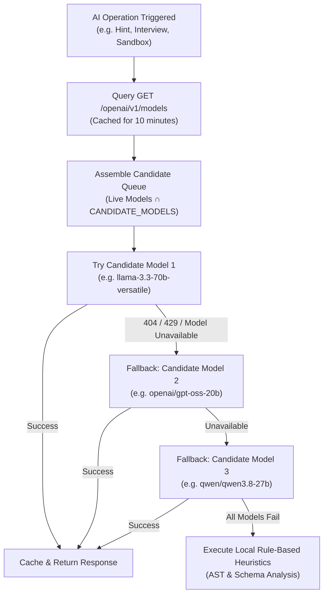

# AI Subsystem Audit Report — DataDesk Platform

**Scope:** Groq API Client, Model Fallback Engine, Prompt Engineering, Token Budgets, Error Recovery
**Status:** Complete

---

## 1. Groq Integration & Dynamic Model Discovery

### 1.1 The Model Deprecation Problem:
Earlier versions of the platform hardcoded static model strings such as `llama-3.1-8b-instant` or `llama-3.3-70b-versatile`. When Groq deprecated or restricted specific model tiers, client requests immediately failed with HTTP 404:
`The model 'llama-3.1-8b-instant' does not exist or you do not have access to it.`

### 1.2 Multi-Model Candidate Queue & Dynamic Discovery:
To achieve 99.9% resilience, `frontend/src/lib/groq.js` implements a dynamic discovery and fallback pipeline:

**Candidate Models Sequence:**
1. `llama-3.3-70b-versatile` (Flagship reasoning & complex interview generation)
2. `openai/gpt-oss-20b` (High-speed open architecture alternative)
3. `openai/gpt-oss-120b` (Large parameter reasoning)
4. `qwen/qwen3.8-27b` (High SQL syntax fidelity)
5. `llama-3.1-8b-instant` (Fast lightweight inference)
6. `gemma2-9b-it` (Google lightweight instruction tuned)
7. `mixtral-8x7b-32768` (High context MoE)

---

## 2. Token Budget & Truncation Vulnerabilities

### 2.1 The "Unexpected end of JSON input" Vulnerability:
- **Root Cause Analysis:**
  Generating 5 full SQL questions (with multi-table schemas, column types, sample data, expected outputs, and DDL/INSERT statements) plus 5 conceptual MCQs in a single prompt frequently exceeds 3,500–4,000 output tokens.
  When an LLM hits `max_tokens`, its response terminates abruptly mid-token (e.g. `{"question": "What is an index... [EOF]`).
  Standard `JSON.parse()` immediately throws:
  `SyntaxError: Unexpected end of JSON input`.
- **Mitigation & Recovery Strategy:**
  1. **Compact Prompting:** Prompts limit sample rows to 4–6 and INSERT rows to 6–10, cutting output token volume by ~45%.
  2. **Truncation Recovery (`safeParseJsonArray`):** When direct parsing fails, the recovery algorithm scans backwards from the end of the text to locate the last completed object brace `}`, closes the array with `]`, and parses the valid subset of questions.
  3. **Procedural Fallback Generator:** If zero questions can be salvaged from a broken network stream, the system procedurally synthesizes realistic SQL questions from the active schema tables (e.g. row counts, column aggregations, top-5 filtering). The UI never displays a broken screen.

---

## 3. Feature Breakdown & Prompt Engineering

### 3.1 AI Personalized Hints (`QuestionHintSection.jsx` & `AiHintPanel.jsx`)
- **Dual-State System:**
  - If user SQL is present: Prompt instructs the model to act as an elite interview coach identifying the candidate's specific logical flaw without giving away the answer.
  - If user SQL is empty: Prompt provides a conceptual roadmap (which tables and SQL clauses to use).
- **Offline / No-Key Resilience:**
  - If no Groq API key is configured or the network drops, `AutoHintMiddleware.js` analyzes the query AST locally using keyword heuristics (e.g. detects missing `GROUP BY` with aggregate functions, table name typos, or unhandled `NULL` filters).

### 3.2 AI Sandbox Dataset & Question Builder (`CustomDatasetPage.jsx`)
- Builds a custom SQLite sandbox from any natural language prompt (e.g. "Hospital surgery wait times" or "FinTech micro-lending defaults").
- Executes the generated DDL and INSERT statements in the Web Worker and immediately reflects the tables in the interactive Schema Explorer.

### 3.3 Proctored Interview Simulation (`useInterviewSession.js` & `chatInterview`)
- Generates 5 realistic domain-specific business scenarios (e.g. Ride-sharing surge pricing, Healthcare patient encounters, EdTech course completion).
- AI Interviewer chatbot enforces a **Strict No-Code Policy** in system prompt, refusing to write answers while offering hints, constraint clarifications, and conceptual feedback.
