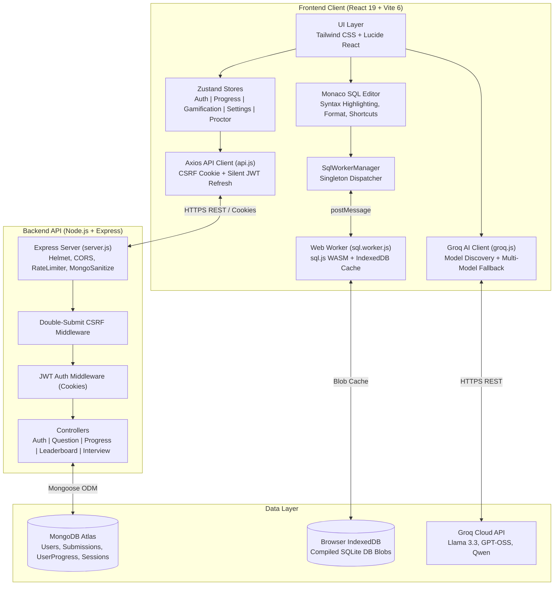
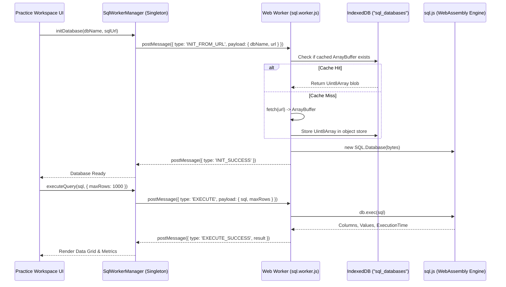
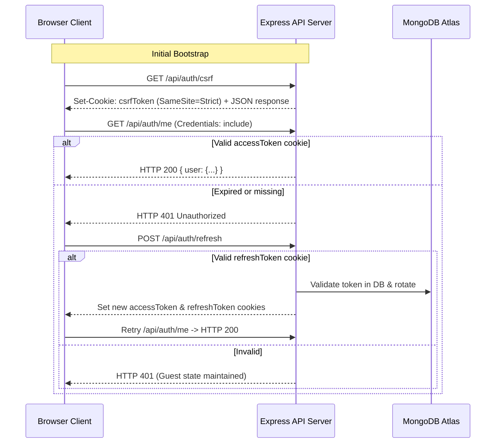

# Architecture Audit Report — DataDesk Platform

**Product Name:** DataDesk (SQL Learning & Technical Interview Platform)  
**Date:** November 2026  
**Auditor:** Principal Software Architect & Full-Stack Systems Specialist  
**Status:** Complete  

---

## 1. Executive Summary

DataDesk is an interactive browser-first SQL education and technical interview simulation platform. Unlike traditional SQL practice platforms that proxy every database query to remote server containers, DataDesk operates an **edge-first client-side WebAssembly execution engine** powered by `sql.js` (SQLite compiled to WASM) running inside dedicated Web Workers.

This architecture offers:
- **Zero backend execution cost & zero latency** for arbitrary SQL queries.
- **Total sandbox isolation** (user queries cannot compromise backend infrastructure).
- **Offline capability** for core practice databases.

However, the application couples client-side execution with:
1. **A Node.js/Express + MongoDB backend** for authentication, user profiles, progress sync, submissions, comments, and leaderboards.
2. **Groq Cloud LLM APIs** for automated schema generation, personalized AI hints, proctored mock interview generation, and query explanations.

---

## 2. High-Level System Architecture

---

## 3. Component Hierarchy & Module Breakdown

### 3.1 Frontend Architecture (`frontend/src/`)
- **`App.jsx`**: Top-level router using `react-router-dom` v7 with routes:
  - `/`: `HomePage.jsx` (Hero, Practice DB catalog, Daily challenge, Feature highlights)
  - `/practice/:dbName`: `PracticePage.jsx` (Core interactive SQL IDE workspace)
  - `/sandbox`: `CustomDatasetPage.jsx` (Custom CSV/SQL upload, AI sandbox generation)
  - `/interviews`: `InterviewPreFlight.jsx` (Permissions check, camera/screen verification, proctoring setup)
  - `/interview/arena`: `InterviewArena.jsx` (Proctored multi-domain technical assessment)
  - `/interview/report`: `InterviewReport.jsx` (Detailed AI & deterministic scorecard)
  - `/company-prep`: `CompanyPrepPage.jsx` (Curated questions by company: Meta, Google, Uber, Amazon, etc.)
  - `/leaderboard`: `LeaderboardPage.jsx` (Global XP & streak rankings)
  - `/profile`: `ProfileView.jsx` (Analytics radar, activity heatmap, league progression, discussions)
- **`features/practice/`**:
  - `SqlEditor.jsx`: Monaco editor instance configured with SQL language support, schema autocompletion, `Ctrl+Enter` execution, `Ctrl+Q` formatting.
  - `ResultsPanel.jsx`: Dual-view results renderer (Table grid vs Diff viewer vs Execution metrics).
  - `SchemaSidebar.jsx`: Interactive schema explorer with searchable tables, primary key indicators, copyable identifiers, and row previews.
  - `QuestionHintSection.jsx`: 3-tier progressive hints + AI personalized hint module.
- **`features/interview/`**:
  - `InterviewArena.jsx`: Timed assessment environment with camera PIP feed, question drawer, Monaco editor, test result console.
  - `hooks/useInterviewSession.js`: Session state machine managing question traversal, timer, answers persistence, and SQLite database switching.
  - `hooks/useProctoring.js`: Fullscreen enforcement, visibility/tab switch detection, devtools deterrence, integrity logging.

### 3.2 State Management Architecture (Zustand)
1. **`useAuthStore`**: Stores `user` object, session status (`loading`, `authenticated`, `guest`), login/logout methods, and profile update actions.
2. **`useProgressStore`**: Tracks per-question completion status (`complete` | `attempted`), handles optimistic local updates, and syncs from `/api/progress`.
3. **`useGamificationStore`**: Manages user activity heatmap data, current/max streaks, badges earned, and recent submission history.
4. **`useSettingsStore`**: User preferences (dark mode, editor font size, vim/normal mode, auto-run query on select, custom Groq API key).
5. **`useProctorStore`**: Media streams (`cameraStream`, `screenStream`), integrity violations counter, and persistent session recovery buffers.

---

## 4. SQL Execution Pipeline (WebAssembly Web Worker)

### Safety & Resilience Controls:
- **Infinite Loop Protection**: `sql.worker.js` enforces a 15-second execution ceiling. If an unindexed Cartesian product or infinite recursive CTE runs longer than 15s, the worker terminates and re-spawns cleanly.
- **LRU Query Caching**: Common SELECT queries are hashed and cached up to 50 entries to avoid re-parsing repetitive ASTs.
- **Memory Ceiling**: Worker catches out-of-memory errors and cleans up SQLite statement handles before leaking heap.

---

## 5. Client-Server Communication & Auth Flow

---

## 6. Architectural Debt & Risks

| Area | Issue | Architectural Risk | Recommendation |
| :--- | :--- | :--- | :--- |
| **Gamification** | Unconditional XP gain in `progressController.js` | Users can farm unlimited XP/ELO by repeatedly executing the same accepted query. | Check `Submission.exists({ userId, questionId, status: 'Accepted' })` before awarding first-time XP. |
| **Gamification** | Level & Rank Title never recalculated | `doc.level` defaults to 1 and `doc.rankTitle` defaults to 'Novice' forever in DB. | Implement deterministic formula `Math.floor(Math.sqrt(totalXp / 50)) + 1` and update on save. |
| **Leaderboard** | Non-distinct question count in aggregation | Aggregates all accepted submission rows instead of unique question IDs. | Aggregate with `$group: { _id: { userId: '$userId', questionId: '$questionId' } }`. |
| **AI Subsystem** | Hardcoded models & token truncation | Single hardcoded model IDs trigger 404s when deprecated by Groq. Truncated JSON crashes with syntax error. | Use dynamic model discovery, multi-model candidate queue, and safe partial JSON recovery parser. |
| **Frontend State** | Monolithic state in `useInterviewSession` | Mixing network generation, DB switching, proctoring, and timer in one hook increases re-render footprint. | Decouple database switching and proctoring streams into dedicated sub-hooks. |
