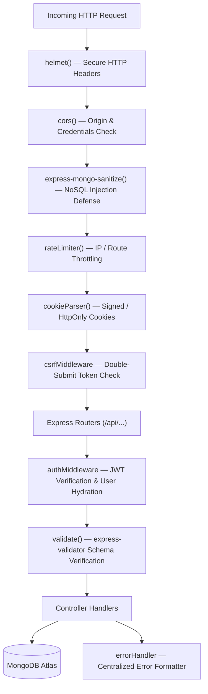

# Backend Audit Report — DataDesk Platform

**Scope:** `backend/`
**Technologies:** Node.js, Express.js, MongoDB, Mongoose 8, JWT, express-validator
**Status:** Complete

---

## 1. Server Architecture & Middleware Pipeline



### 1.1 Middleware Analysis:
1. **`helmet`**: Configures Content Security Policy (CSP), Strict-Transport-Security (HSTS), X-Content-Type-Options, and X-Frame-Options.
2. **`cors`**: Restricted to authorized frontend origins (e.g. `http://localhost:5173` and production domain `https://datadesk.live`) with `credentials: true`.
3. **`express-mongo-sanitize`**: Strips `$` and `.` prefixes from `req.body`, `req.query`, and `req.params` to prevent NoSQL query injection.
4. **`rateLimiter`**: Express-rate-limit configured with distinct limiters for auth endpoints (strict: 10 req/15min) and general data endpoints (generous: 300 req/15min).
5. **`csrf`**: Enforces double-submit CSRF token validation on all state-changing methods (`POST`, `PUT`, `PATCH`, `DELETE`).
6. **`auth`**: Extracts JWT from `accessToken` cookie. Verifies signature using `JWT_SECRET`. Attaches hydrated `req.user`.

---

## 2. Controllers & Business Logic Audit

### 2.1 Progress Controller (`progressController.js`)
- **Key Functions:**
  - `getProgress`: Retrieves user progress, computes activity heatmap (last 365 days), and aggregates completed questions from `Submission`.
  - `recordActivity`: Records query attempts in `Submission`, updates streaks, awards XP, and computes badges.
- **Critical Gamification Bug Discovered:**
  - **Issue:** Whenever `isAccepted === true`, the controller unconditionally executed:
    ```javascript
    doc.totalXp += xpGain;
    doc.eloRating += Math.round(xpGain / 2);
    ```
    Repeatedly running an accepted query on the same question farmed infinite XP.
  - **Root-Cause Fix:** Added a check for existing accepted submissions:
    ```javascript
    const alreadyAccepted = await Submission.exists({
      userId: req.user._id,
      questionId: String(question.id),
      status: 'Accepted'
    });
    if (!alreadyAccepted) {
      doc.totalXp += xpGain;
      doc.eloRating += Math.round(xpGain / 2);
    }
    ```
  - **Level & Rank Calculation Fix:**
    Previously `doc.level` (1) and `doc.rankTitle` ('Novice') were never computed. Implemented deterministic level formula:
    `doc.level = Math.floor(Math.sqrt(doc.totalXp / 50)) + 1;`
    And updated `doc.rankTitle` according to XP tiers.

### 2.2 Leaderboard Controller (`leaderboardController.js`)
- **Key Functions:**
  - `getLeaderboard`: Returns top users ordered by `totalXp` and `maxStreak`.
- **Aggregation Bug Discovered:**
  - **Issue:** Completed question count was computed via:
    `{ $match: { userId: { $in: userIds }, status: 'Accepted' } }, { $group: { _id: '$userId', count: { $sum: 1 } } }`
    This counted every accepted submission attempt instead of distinct questions solved.
  - **Root-Cause Fix:** Group by distinct `(userId, questionId)` first:
    ```javascript
    const completedCounts = await Submission.aggregate([
      { $match: { userId: { $in: userIds }, status: 'Accepted' } },
      { $group: { _id: { userId: '$userId', questionId: '$questionId' } } },
      { $group: { _id: '$_id.userId', count: { $sum: 1 } } },
    ]);
    ```

### 2.3 Authentication Controller (`authController.js`)
- **Strengths:**
  - Secure cookie storage (`HttpOnly`, `SameSite=Lax/Strict`, `Secure` in production).
  - Refresh token rotation in `RefreshToken` collection with reuse detection.
  - Password hashing using `bcrypt` (10 salt rounds).
  - Guest/unauthenticated fallback: `/api/auth/me` returns 401 cleanly without server error logs.

---

## 3. Database Models & Schema Audit (Mongoose)

| Model | Collection | Primary Indexes | Secondary / Compound Indexes | Optimization Status |
| :--- | :--- | :--- | :--- | :--- |
| `User` | `users` | `_id` | `email` (unique) | Optimal |
| `UserProgress` | `userprogresses` | `_id` | `userId` (unique), `{ totalXp: -1, maxStreak: -1 }` | Indexed for Leaderboard |
| `Submission` | `submissions` | `_id` | `{ userId: 1, questionId: 1 }`, `{ createdAt: -1 }` | Compound index prevents table scans |
| `RefreshToken` | `refreshtokens` | `_id` | `token` (unique), `expiresAt` (TTL index) | Auto-purging expired tokens |
| `InterviewSession` | `interviewsessions` | `_id` | `{ userId: 1, createdAt: -1 }` | Fast user history lookup |
| `Comment` | `comments` | `_id` | `{ questionId: 1, createdAt: -1 }` | Efficient discussion threads |

---

## 4. API Response Standards & Error Handling

All endpoints follow the uniform JSON envelope standard:
```json
{
  "success": true,
  "message": "Operation successful",
  "data": { ... }
}
```
Error responses adhere to:
```json
{
  "success": false,
  "message": "Validation Error or Business Logic Exception",
  "errors": [ ... ]
}
```
`errorHandler.js` intercepts unhandled exceptions, strips stack traces in production (`process.env.NODE_ENV === 'production'`), and returns structured HTTP 400, 401, 403, 404, or 500 status codes.
