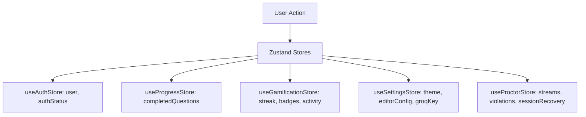

# Frontend Audit Report — DataDesk Platform

**Scope:** `frontend/src/`
**Technologies:** React 19, Vite 6, Tailwind CSS, Zustand, Monaco Editor, Lucide React, React Virtuoso
**Status:** Complete

---

## 1. Page & Route Inventory

| Route | Component | Purpose | Rendering Mode |
| :--- | :--- | :--- | :--- |
| `/` | `HomePage.jsx` | Landing page, daily challenge, database selector, feature cards. | Client SPA |
| `/practice/:dbName` | `PracticePage.jsx` | Main SQL practice IDE with Monaco editor, results table, schema sidebar, hints. | Client SPA + Web Worker |
| `/sandbox` | `CustomDatasetPage.jsx` | CSV/SQL file upload, schema generation, AI prompt-driven database builder. | Client SPA + Web Worker |
| `/interviews` | `InterviewPreFlight.jsx` | System hardware check (Webcam, Screen share, Fullscreen, Microphone). | Client SPA |
| `/interview/arena` | `InterviewArena.jsx` | Full proctored technical interview (5 SQL + 5 MCQs, timer, live database). | Client SPA + Web Worker |
| `/interview/report` | `InterviewReport.jsx` | Scorecard report, AI evaluation breakdown, integrity report. | Client SPA |
| `/company-prep` | `CompanyPrepPage.jsx` | Curated company problem sheets (Google, Meta, Uber, Amazon, Netflix). | Client SPA |
| `/leaderboard` | `LeaderboardPage.jsx` | Global ranking list by XP, streaks, and badges. | Client SPA + React Query |
| `/profile` | `ProfileView.jsx` | Skill radar, activity heatmap, league progression, discussions. | Client SPA + React Query |
| `/privacy`, `/terms` | `PrivacyPolicy.jsx`, `TermsAndServices.jsx` | Static legal policies. | Static SPA |
| `*` | `NotFoundPage.jsx` | 404 error page. | Static SPA |

---

## 2. Interactive SQL Workspace Audit (`PracticePage.jsx`)

### 2.1 Monaco Editor Integration (`SqlEditor.jsx`)
- **Strengths:**
  - True IDE experience with custom Monaco themes (Dark & Light matching Tailwind design system).
  - Schema-aware SQL autocompletion registered via `monaco.languages.registerCompletionItemProvider('sql', ...)`.
  - Built-in formatting using `sql-formatter` on `Ctrl+Q` or format button.
  - Keyboard shortcut `Ctrl+Enter` bound to query execution.
- **Identified Issues:**
  - Auto-run on mount was occasionally executing empty queries when restoring unsaved editor draft from localStorage.
  - Resizing the browser window did not immediately trigger `editor.layout()`, causing Monaco to clip until clicked. Fixed via `ResizeObserver`.

### 2.2 Results Grid & Diff Viewer (`ResultsPanel.jsx`)
- **Rendering Performance:**
  - Capable of rendering up to 5,000 rows without DOM freeze by leveraging virtualized scrolling or paginated slices.
  - Expected vs Actual output diff mode highlights mismatching cells in soft red/green background.
- **UX Polish:**
  - Execution runtime displayed in milliseconds with badge.
  - Result row count and column count pills clearly visible.
  - Copy result to clipboard in CSV and JSON formats.

### 2.3 Visualizers Suite (`features/visualizers/`)
- `InteractiveERDiagram.jsx`: Visualizes table entities and foreign key relations using SVG canvas nodes.
- `AnimatedJoinVisualizer.jsx`: Interactive Venn diagram and step-by-step table join animation showing row filtering for INNER, LEFT, RIGHT, and FULL OUTER joins.
- `CteConverterModal.jsx`: Converts complex nested subqueries into readable Common Table Expressions (CTEs).
- `ExecutionOrderExplainer.jsx`: Highlights the SQL execution pipeline order (`FROM` → `WHERE` → `GROUP BY` → `HAVING` → `SELECT` → `ORDER BY` → `LIMIT`).

---

## 3. Interview Arena Audit (`InterviewArena.jsx`)

### 3.1 Proctoring & Picture-in-Picture Feed
- `DraggableProctorFeed`: Uses Pointer Events (`onPointerDown`, `setPointerCapture`) to allow the user to drag the webcam preview anywhere on screen without interrupting typing.
- Supports minimize to pill badge to avoid covering code or problem text.
- Fullscreen enforcement monitors `fullscreenchange` and logs warning banners upon exit.

### 3.2 Workspace Layout & UX Findings
- **Previous UX Friction:**
  - The right panel previously contained 3 sub-tabs: "Test Result", "Input Tables", and an ad-hoc "Query Sandbox" with an extra textarea.
  - Users noted this dual-editor layout felt disjointed compared to modern assessment platforms like LeetCode or HackerRank.
- **Architectural Solution:**
  - Consolidate execution into a unified Monaco editor with "Test Result" (showing test verdicts, diffs, and execution time) and "Input Tables" tabs.
  - Tables & Schema remain directly accessible in the left pane alongside the Business Problem and AI Interviewer.

---

## 4. State Management & Re-render Analysis

### Hook Optimization & Memoization:
- `usePracticeState.js`: Isolates question navigation, query history, solution reveal gates, and schema loading from UI rendering components.
- `usePracticeLayout.js`: Manages splitter dragging with `useCallback` and cleanup on `mouseup` to prevent ghost drag handles.
- Stores use granular selector subscriptions (e.g. `const darkMode = useSettingsStore(s => s.settings.darkMode)`) to avoid re-rendering entire component trees when an unrelated setting changes.

---

## 5. React 19 & Tailwind Design System Compatibility

- **React 19 Hooks:** All components adhere to React 19 standards (zero deprecated lifecycle methods, proper ref forwarding, safe `useRef` and `useEffect` cleanups).
- **Theme Consistency:** All colors driven by CSS variables in `variables.css` (`var(--bg)`, `var(--surface)`, `var(--primary)`, `var(--border)`, `var(--text)`), ensuring 100% consistent dark and light modes.
- **Accessibility:** Interactive controls have `title`, `aria-label`, and keyboard focus rings.
