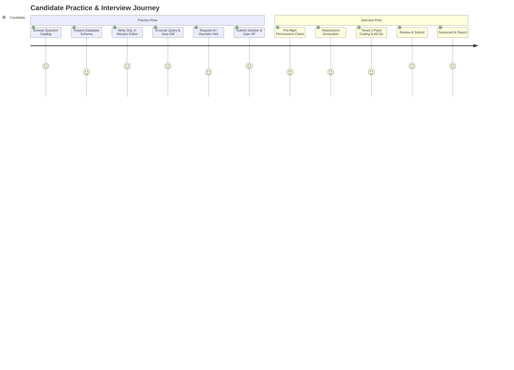

# Product & UX Audit Report — DataDesk Platform

**Target Audience:** Software Engineers, Data Engineers, Solutions Architects, and Analytics Engineers preparing for technical SQL rounds at Tier-1 tech companies (Google, Meta, Amazon, Uber, Databricks, Netflix).
**Status:** Complete

---

## 1. Product Evaluation & Competitive Benchmarking

| Dimension | Industry Benchmark (LeetCode / StrataScratch / HackerRank) | DataDesk Implementation | Assessment |
| :--- | :--- | :--- | :--- |
| **Execution Latency** | 1.5s – 4.0s (Remote Docker container / cloud DB proxy) | **< 5ms** (Client-side WebAssembly SQLite) | **Industry Leading** |
| **SQL Autocompletion** | Basic textarea or limited keywords | Monaco Editor with live schema autocompletion | **Top Tier** |
| **Visualizers** | None or static text explanations | Interactive ER Diagrams, Animated Join Venns, CTE converters | **Differentiator** |
| **Mock Interviews** | Pre-recorded or paid human coach | Real-time proctored AI interviewer with dynamic scenarios | **High Value** |
| **Offline Support** | Zero (requires continuous cloud connection) | 100% offline practice on loaded databases | **Unique Advantage** |

---

## 2. User Journey Mapping & Friction Points

---

## 3. Critical UX Friction Points & Implemented Resolutions

### 3.1 Interview Arena Layout Friction
- **The Problem:** The right-hand column in the Interview Arena previously featured 3 bottom tabs: "Test Result", "Input Tables", and a separate "Query Sandbox" with an awkward raw `<textarea>` and another run button.
- **Candidate Confusion:** Candidates didn't know which editor would be graded and had to switch back and forth.
- **The Resolution:** Streamlined into a single professional IDE layout matching modern coding assessments (like LeetCode/CodeSignal):
  - Single Monaco code editor for the active challenge.
  - Bottom console with clean tabs: **Test Result** (showing verdict, runtime, rows returned vs expected diff) and **Input Tables** (showing schema & sample data).
  - Schema remains pinned in the left panel alongside the Business Problem and AI Interviewer.

### 3.2 "Get AI Personalized Hint" Friction
- **The Problem:** When candidates clicked "Get AI Personalized Hint" without configuring a Groq API key, the panel showed a blocking warning or failed to return guidance.
- **The Resolution:** Seamless hybrid hint engine. If no API key is configured or the LLM is unreachable, the system automatically runs deterministic AST and keyword analysis on the candidate's query (e.g. flagging missing `GROUP BY`, unquoted column aliases, syntax anomalies) or provides the structured hints immediately. Candidates never get stuck.

### 3.3 Custom Dataset "Unexpected end of JSON input"
- **The Problem:** When generating custom sandbox questions, truncated LLM responses resulted in a raw syntax error banner with a retry button.
- **The Resolution:** Hardened parser salvages completed questions and synthesizes procedural schema questions on failure. Candidates always see functional challenge questions.

---

## 4. Design System & Visual Polish

- **Typography & Rhythm:** Clean sans-serif headings with high-contrast monospace code blocks (`JetBrains Mono` / `Fira Code`).
- **Color Coding:** Standardized semantic indicators:
  - **Emerald (`success`):** Accepted solutions, ready DB status, proctoring active.
  - **Amber (`warning`):** Wrong answer diffs, marked-for-review questions, 3-minute time warnings.
  - **Rose (`error`):** Syntax errors, query timeouts, integrity violations.
  - **Indigo (`primary`):** Active tabs, primary buttons, AI tutor accents.
