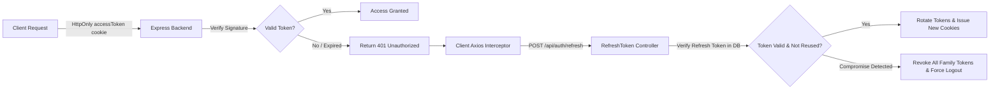

# Security Audit Report — DataDesk Platform

**Scope:** Full-Stack (Frontend, Backend, Database, WebAssembly Sandbox, AI Integrations)  
**Classification:** Critical Platform Security Review  
**Status:** Complete  

---

## 1. Threat Model & Security Posture

DataDesk presents a unique threat surface due to its edge-first architecture:
1. **User SQL Execution:** Executes completely inside an isolated WebAssembly sandbox in the user's browser. There is **zero backend SQL injection attack surface** because the server executes no user-provided SQL.
2. **Backend API:** Traditional Node.js/Express REST API communicating with MongoDB Atlas.
3. **AI Cloud Calls:** Client-direct or server-assisted communication with Groq Cloud LLM endpoints.
4. **Proctored Assessments:** Client-side anti-cheat mechanisms monitoring user environment integrity.

---

## 2. Authentication & Session Security



### 2.1 Cookie Security
- `accessToken` and `refreshToken` are stored in `HttpOnly`, `SameSite=Lax` (or `SameSite=None` in cross-origin production with `Secure: true`) cookies.
- JavaScript cannot access authentication cookies via `document.cookie`, mitigating XSS credential theft.

### 2.2 Refresh Token Rotation & Reuse Detection
- Refresh tokens are hashed and stored in MongoDB with a unique family ID.
- When refreshed, the old refresh token is invalidated, and a new one is issued.
- If an invalidated refresh token is presented (indicating possible token interception), the backend automatically invalidates the entire token family, forcing all sessions to re-authenticate.

---

## 3. Cross-Site Request Forgery (CSRF) Defense

DataDesk implements the **Double-Submit Cookie CSRF Pattern**:
1. Client bootstraps a CSRF token via `GET /api/auth/csrf`.
2. Backend sets a non-HttpOnly cookie `csrfToken` and returns the token in the JSON payload.
3. On every state-changing request (`POST`, `PUT`, `PATCH`, `DELETE`), the frontend includes the token in the `X-CSRF-Token` HTTP header.
4. The `csrf` middleware strictly asserts:
   ```javascript
   const headerToken = req.headers['x-csrf-token'];
   const cookieToken = req.cookies['csrfToken'];
   if (!headerToken || !cookieToken || headerToken !== cookieToken) {
     return res.status(403).json({ success: false, message: 'Invalid CSRF token' });
   }
   ```
This blocks cross-origin malicious form submissions and forged requests from third-party websites.

---

## 4. SQL Injection & WebAssembly Sandbox Boundary

| Layer | Risk | Mitigation | Status |
| :--- | :--- | :--- | :--- |
| **Backend API** | SQL Injection | Backend does not connect to any SQL database (uses MongoDB via Mongoose). | **Zero Attack Surface** |
| **Frontend Sandbox** | Host OS Compromise | `sql.js` runs purely within the browser's WebAssembly linear memory inside a Web Worker. It has no access to the host filesystem, sockets, or processes. | **Sandboxed** |
| **Sandbox DoS** | Infinite Query Loops | 15-second worker timeout forcibly terminates execution if a Cartesian product or runaway recursive CTE is run. | **Protected** |

---

## 5. AI API Key Security & Architecture

### 5.1 Analysis of Client-Side API Keys:
- **Current Behavior:** The frontend supports:
  1. Local custom key entered in Settings modal, stored in `localStorage` under `sql-platform-settings`.
  2. Optional environment variable `VITE_GROQ_API_KEY`.
- **Security Assessment:**
  - `VITE_*` environment variables are bundled into client-side JS bundles. If a platform owner includes a shared production key in `.env.production`, malicious users could inspect network traffic and extract the key.
  - Using user-provided keys stored in `localStorage` isolates costs and API quotas to the user's personal Groq account.
- **Architectural Hardening:**
  - Key sanitization (`cleanApiKey`) strips unwanted characters, whitespace, and `Bearer ` prefixes.
  - Settings Modal provides a visual connection tester that verifies validity via `GET /openai/v1/models` without leaking keys to server logs.
  - For enterprise/managed deployments, proxying AI requests through a dedicated backend route (`/api/ai/...`) with server-side rate-limiting and user tier validation is recommended.

---

## 6. Proctoring & Anti-Cheat Evaluation (`InterviewArena.jsx`)

1. **Fullscreen Enforcement:**
   - Detects `fullscreenchange` events. If the user exits fullscreen (e.g. pressing ESC), a warning banner appears and an integrity breach event is recorded.
2. **Tab / Application Switching:**
   - Listens to document `visibilitychange`. If `document.hidden` becomes true (switching to another browser tab or minimizing), an event is appended to the session violation log.
3. **Restricted Actions & Keyboard Interception:**
   - `Ctrl+C` (Copy) and `Ctrl+V` (Paste) are intercepted in the editor during proctored mode to encourage genuine problem solving.
   - `F12` and context-menu inspections are flagged.
4. **Media Streams:**
   - WebRTC media tracks (`cameraStream`, `screenStream`) run locally and are displayed via Picture-in-Picture. Streams are explicitly cleaned up on unmount (`track.stop()`), ensuring user webcam indicators turn off immediately upon test completion.
