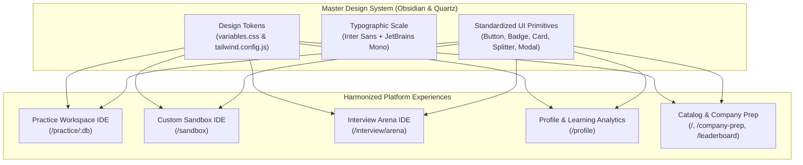
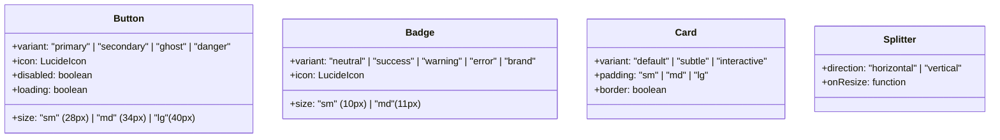
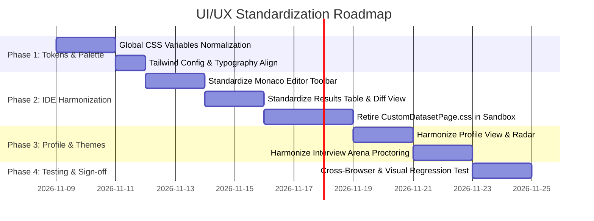

# Unified UI/UX Design System & Architectural Standardization Specification

**Product:** DataDesk (SQL Practice, Sandbox & Technical Interview Platform)
**Document:** Master UI/UX Overhaul & Cross-Platform Theme Harmonization Blueprint
**Status:** Approved Architectural Specification
**Design Philosophy:** High-Craft Developer First (Linear, Vercel, Supabase, LeetCode grade)

---

## 1. Executive Diagnosis — The "AI-Generated UI" Syndrome

### 1.1 The Core Problem
The current DataDesk frontend exhibits symptoms common to fast-iterated, agentic AI-generated applications:
1. **Visual Fragmentation Across Pages:**
   - **Profile View:** Styled with custom purple/indigo gradients (`#6366f1`, `#8b5cf6`), oversized `rounded-[24px]` radius, heavy colored glow shadows (`shadow-[0_4px_16px_rgba(0,0,0,0.08)]`), and distinct card wrappers that feel like a completely different SaaS product.
   - **Practice IDE:** Styled with neutral borders, standard Tailwind classes, and amber/blue accents.
   - **Interview Arena:** Styled with custom dark proctoring tags, custom PIP badges, and high-contrast red violation banners.
   - **Sandbox (`CustomDatasetPage.jsx`):** Renders with its own **1,392-line standalone CSS file** (`CustomDatasetPage.css`) defining isolated `.sb-`, `.qp-`, and `.cds-` classes, creating divergent button padding, conflicting fonts, and custom layout rules.
2. **Icon & Text Clutter:**
   - Icons are sprinkled on almost every label, button, column header, and tab without functional hierarchy (e.g., table cells with icons, badges with multiple icons, multiple competing sparkles and flames).
   - Arbitrary text sizing: A single screen mixes `text-[8px]`, `text-[10px]`, `text-[11px]`, `text-xs`, `text-[13px]`, `text-sm`, `text-[14px]`, `text-base` without a strict typographic scale.
3. **Fragmented Execution Experiences:**
   - The core IDE experience (running SQL, viewing output tables, reviewing errors, inspecting schema) looks and behaves differently in the Practice Page, the Sandbox, and the Interview Arena.

---

## 2. The Unified Design Standard ("Obsidian & Quartz")

DataDesk will adhere to a single, uncompromising design language inspired by world-class developer tools (**Linear**, **Vercel**, **Supabase**, and **GitHub**):
- **Quiet, High-Contrast Precision:** Subtle borders, crisp typography, subdued backgrounds, and deliberate semantic color accents.
- **Zero Icon Noise:** Icons exist strictly to establish spatial anchor points or convey state (run, warning, checkmark). No decorative icons next to plain text labels where text alone is clearer.
- **Unified IDE Core:** A candidate practicing a hospital query, generating an AI sandbox dataset, or taking a proctored FAANG mock assessment must experience the **exact same editor toolbar, table grid, diff viewer, and shortcut ergonomics**.



---

## 3. Global Design Tokens & Unified Palette

### 3.1 Semantic Color System (`variables.css`)
No hardcoded hex codes (`#6366f1`, `#8b5cf6`, `#b45309`) will be permitted in feature components. All styling references CSS variables:

| Token | Light Theme (Quartz) | Dark Theme (Obsidian) | Purpose |
| :--- | :--- | :--- | :--- |
| `--bg` | `#f8f9fa` | `#0d0e11` | Application base background |
| `--surface-canvas` | `#ffffff` | `#131418` | Main content panels, editor backdrop |
| `--surface-panel` | `#f3f4f6` | `#1a1b20` | Sidebars, console drawers, table headers |
| `--surface-hover` | `#e5e7eb` | `#23252b` | Hover state for interactive items |
| `--border-subtle` | `#e5e7eb` | `#23262d` | Inner table cells, secondary dividers |
| `--border-default` | `#d1d5db` | `#2e323b` | Main panel borders, card containers |
| `--border-focus` | `#111827` | `#6366f1` | Active editor focus, selected tabs |
| `--text-primary` | `#111827` | `#f3f4f6` | Primary headings, code text, active labels |
| `--text-secondary` | `#4b5563` | `#9ca3af` | Explanations, hints, metadata |
| `--text-muted` | `#6b7280` | `#6b7280` | Timestamps, column types, hotkeys |
| `--accent-brand` | `#4f46e5` (Indigo) | `#6366f1` (Indigo Glow) | Primary brand accent across all pages |
| `--success` | `#059669` (Emerald) | `#10b981` (Emerald) | Accepted query, completed question |
| `--warning` | `#d97706` (Amber) | `#f59e0b` (Amber) | Wrong answer, constraints, warnings |
| `--error` | `#dc2626` (Rose) | `#ef4444` (Rose) | Runtime syntax error, test termination |

---

## 4. Typographic & Iconography Hierarchy

### 4.1 Strict Typographic Scale
- **Headings (Sans - `Inter`):**
  - Section Title: `text-base font-bold` (15px / line-height 22px)
  - Modal / Card Header: `text-sm font-semibold` (13.5px / line-height 20px)
  - Overline / Eyebrow Tag: `text-[11px] font-bold uppercase tracking-wider`
- **Body & Metadata (Sans - `Inter`):**
  - Standard Body: `text-xs font-normal` (12.5px / line-height 19px)
  - Secondary Metadata: `text-[11px] font-medium text-text-secondary`
  - Inline Hotkey / Badge: `text-[10px] font-mono font-bold tracking-tight`
- **Code & Data Tables (Mono - `JetBrains Mono` / `Fira Code`):**
  - Editor & Table Cell: `font-mono text-xs` (12px / line-height 18px)
  - Column Data Type: `font-mono text-[10px] uppercase opacity-75`

### 4.2 Iconography Rules
1. **Maximum 1 Icon Per Action:** Never stack multiple icons in a single button or badge.
2. **Fixed Icon Dimensions:**
   - Inline status dots: `size={8}`
   - Action / Tab icons: `size={13}` or `size={14}`
   - Prominent header icons: `size={16}`
3. **No Redundant Icons:** Remove decorative sparkles, moons, or databases from standard text headers where the label is self-explanatory.

---

## 5. The Standardized IDE Workspace Specification

Whether a candidate is on `/practice/hospital`, `/sandbox`, or `/interview/arena`, the IDE layout, toolbar heights, button alignments, and results presentation must be **100% identical**:

```
+-----------------------------------------------------------------------------------------------+
| TOPBAR (48px): [Logo / Brand] | [Breadcrumb Navigator]        | [Timer/Stats] [Theme] [Profile] |
+---------------------------------------+-------------------------------------------------------+
| LEFT PANE (38-42%):                   | RIGHT PANE (58-62%):                                  |
| +-----------------------------------+ | +---------------------------------------------------+ |
| | TABS (36px): Problem | Schema | AI | | | TOOLBAR (38px): [Run Code] [Format] [History]      | |
| +-----------------------------------+ | +---------------------------------------------------+ |
| |                                   | |                                                     | |
| | Business Problem / Schema Tree    | | MONACO SQL CODE EDITOR                              | |
| | - Clear Constraints Box           | | - Line numbers, syntax highlighting, autocompletion | |
| | - Copyable Identifiers            | |                                                     | |
| | - Expected Output Sample          | |                                                     | |
| |                                   | +---------------------------------------------------+ |
| |                                   | | DRAGGABLE VERTICAL SPLITTER (6px)                   | |
| |                                   | +---------------------------------------------------+ |
| |                                   | | CONSOLE / RESULTS PANEL (Resizable):                | |
| |                                   | | [Test Result] [Input Tables] [Diff] | [Exec: 3ms]   | |
| |                                   | | +-------------------------------------------------+ | |
| |                                   | | | Verdict Banner: (Accepted / Wrong Answer / Error)| | |
| |                                   | | | Interactive Virtualized Data Grid (Rows / Cols) | | |
| |                                   | | +-------------------------------------------------+ | |
+---------------------------------------+-------------------------------------------------------+
```

### 5.1 Standardized Editor Toolbar (Height: 38px)
- **Left Group:**
  - Context Indicator: Clean pill showing active schema/challenge (`SQLite: hospital`).
  - Auto-saved state checkmark (`Auto-Saved`).
- **Right Group:**
  - `Reset Code` button (Ghost icon button).
  - `Format SQL` button (Ghost icon button with `Ctrl+Q` tooltip).
  - **`Run Code` Primary Button:** High-contrast solid primary action with `Ctrl+Enter` shortcut indicator.

### 5.2 Standardized Results Panel & Diff Viewer
- **Tabs:**
  1. **Test Result:** Shows execution verdict badge, runtime in ms, row count, and actual data table.
  2. **Diff Viewer:** If output differs from expected, visual side-by-side or cell-by-cell highlighting (soft green for matching, soft red for mismatching, amber for missing rows).
  3. **Input Tables:** Clean tab with schema definitions and 5 representative rows per table.
- **Data Table Presentation:**
  - Fixed row height (28px).
  - Sticky header with subtle border and monospace column names.
  - Alternating subtle row backgrounds (`var(--surface-canvas)` and `var(--surface-panel)`).
  - NULL values rendered with an italicized, muted `<span class="opacity-40 italic">NULL</span>`.

---

## 6. Harmonization Plan by Page

### 6.1 Profile & Analytics View (`ProfileView.jsx` & `DashboardTab.jsx`)
- **Current Issues:** Bespoke indigo glow, hardcoded purple gradient `#8b5cf6`, `rounded-[24px]` radius.
- **Harmonization Steps:**
  - Replace hardcoded hex colors with design tokens:
    - League colors mapped to semantic tokens (`--accent-brand`, `--warning`, `--success`, `--text-secondary`).
    - Card containers aligned to standard radius `rounded-xl` and standard border `border border-border`.
  - Skill Radar chart background and stroke harmonized to match dark/light theme CSS variables.
  - Activity Heatmap cells restyled to match platform brand colors (`#6366f1` scale) on both themes.

### 6.2 Custom Dataset Sandbox (`CustomDatasetPage.jsx`)
- **Current Issues:** Uses 1392-line `CustomDatasetPage.css` with foreign classes (`.sb-topbar`, `.sb-schema-root`, `.qp-root`).
- **Harmonization Steps:**
  - Completely deprecate and retire `CustomDatasetPage.css`.
  - Refactor `CustomDatasetPage.jsx` to adopt the shared IDE layout:
    - Left column: Unified `SchemaSidebar` component.
    - Center column: Standardized `SqlEditor` and `ResultsPanel`.
    - Right column: Clean, collapsible "AI Questions" drawer with standardized question cards.
  - Top bar styled with standard platform header and clean table tag pills.

### 6.3 Practice IDE (`PracticePage.jsx`)
- **Harmonization Steps:**
  - Standardize button variants across editor toolbar and bottom action bar.
  - Replace inconsistent hint accordions with the unified `QuestionHintSection` (incorporating Instant Coach heuristics).
  - Align splitter handles to a uniform 6px interactive drag strip with smooth hover highlights.

### 6.4 Interview Arena (`InterviewArena.jsx`)
- **Harmonization Steps:**
  - Retain the newly streamlined single-Monaco layout.
  - Polish the top proctoring bar:
    - Question switcher dropdown formatted with clean status dots (green = answered, amber = flagged, neutral = unanswered).
    - Timer displayed with high-contrast font and subtle border.
    - Draggable camera PIP styled with frosted glass backdrop (`backdrop-blur-md`) and clean minimize toggle.

---

## 7. Standardized UI Component Library (Design Primitives)



### 7.1 Unified Button Guidelines
- **Primary:** High-contrast solid button (`bg-primary text-primary-foreground hover:bg-primary-hover`). Used **only once per view** for the main action (e.g. `Run Code`, `Submit Assessment`).
- **Secondary / Outline:** Subtle border with hover fill (`bg-surface-canvas border border-border text-text hover:bg-surface-hover`).
- **Ghost:** Borderless action for utility controls (`bg-transparent text-text-secondary hover:text-text hover:bg-surface-hover`).
- **Danger:** Subtle red background with crisp text (`bg-error/10 text-error border border-error/20 hover:bg-error/20`).

---

## 8. Step-by-Step Implementation & Migration Roadmap



### Phase 1: Foundation (Tokens & Typography)
- Audit and normalize `variables.css` so that light mode (Quartz) and dark mode (Obsidian) share exact contrast ratios.
- Update `tailwind.config.js` to expose strict semantic tokens (`surface-canvas`, `surface-panel`, `border-subtle`, `border-default`).

### Phase 2: Core IDE Standardization
- Refactor `SqlEditor.jsx` toolbar into a reusable primitive used by Practice, Interview Arena, and Custom Dataset.
- Standardize `ResultsPanel.jsx` to render consistent column headers, execution timers, and diff modes across all 3 IDE surfaces.

### Phase 3: Sandbox Migration
- Eliminate the 1,392 lines in `CustomDatasetPage.css`.
- Rebuild `CustomDatasetPage.jsx` using the standard workspace components and Tailwind utilities.

### Phase 4: Profile & Dashboard Overhaul
- Replace hardcoded hex values in `ProfileView.jsx` and `DashboardTab.jsx` with unified CSS variable tokens.
- Harmonize cards, league badges, and radar charts to match the platform's clean aesthetic.

### Phase 5: Verification & Production Polish
- Run full test suites (Vitest, Oxlint, Vite production build).
- Perform visual regression checks across Desktop, Laptop, and Tablet viewport widths in both dark and light modes.
