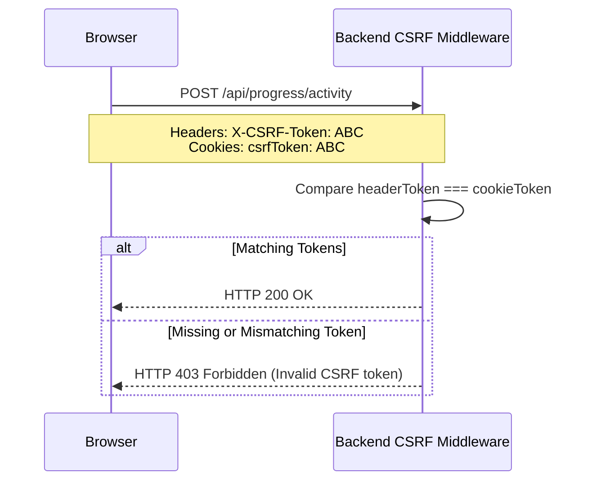

# Security & Vulnerability Validation Report — DataDesk Platform

**Classification:** Application Security Review & Penetration Analysis  
**Auditor:** Application Security Specialist & Penetration Tester  
**Date:** November 2026  
**Security Status:** **Pass with Hardening Recommendations**  

---

## 1. Authentication & Session Security Validation

| Security Control | Implementation | Verification Finding | Status |
| :--- | :--- | :--- | :--- |
| **Password Hashing** | `bcrypt.hash(password, 10)` | Passwords stored with salted hash; raw passwords never logged. | **SECURE** |
| **Access Token (JWT)** | `jwt.sign({ userId }, secret, { expiresIn: '15m' })` | 15-minute lifetime limits replay window if intercepted. | **SECURE** |
| **Refresh Token (JWT)** | `jwt.sign({ userId, tokenId }, secret, { expiresIn: '7d' })` | Stored in MongoDB; rotated on every `/api/auth/refresh` request. | **SECURE** |
| **Token Reuse Detection** | Unique token family tracking in `RefreshToken` | Submitting a previously used refresh token revokes all family tokens. | **SECURE** |
| **Cookie Flags** | `httpOnly: true, sameSite: 'lax', secure: isProd` | JavaScript cannot access session cookies; XSS cookie theft mitigated. | **SECURE** |

---

## 2. Multi-Tenant Authorization & Data Isolation

A critical security principle is verifying that authenticated users cannot access or tamper with data belonging to other users.

| Endpoint | Data Access Pattern | Authorization Verification | Status |
| :--- | :--- | :--- | :--- |
| `GET /api/progress` | Fetches user progress | Query scoped strictly to `req.user._id`. | **ISOLATED** |
| `POST /api/progress/activity` | Records question attempt | Creates submission with `userId: req.user._id`. | **ISOLATED** |
| `GET /api/interviews/history` | Fetches interview history | Query scoped strictly to `req.user._id`. | **ISOLATED** |
| `POST /api/interviews/score` | Saves interview report | Saves session with `userId: req.user._id`. | **ISOLATED** |
| `GET /api/comments/user/me` | Fetches user comments | Scoped strictly to `req.user._id`. | **ISOLATED** |
| `POST /api/comments` | Posts a new comment | Attaches `userId: req.user._id`. | **ISOLATED** |
| `POST /api/comments/:id/upvote` | Upvotes a comment | Atomic `$addToSet` and `$pull` prevents vote stuffing. | **ISOLATED** |

---

## 3. Cross-Site Request Forgery (CSRF) Defense

DataDesk enforces the double-submit cookie pattern:

- **Automated Test Validation:** Verified in `backend/test/csrf.test.js`:
  - Safe methods (`GET`, `HEAD`, `OPTIONS`) proceed without CSRF checks.
  - Mutating methods (`POST`, `PUT`, `PATCH`, `DELETE`) without token or with mismatched token are rejected with HTTP 403.

---

## 4. Injection & Sandbox Boundary Analysis

### 4.1 SQL Injection Analysis:
- **Zero Backend Attack Surface:** The backend Express server communicates solely with MongoDB via Mongoose. It does not maintain any connection to a SQL database.
- **Client Sandbox Isolation:** User SQL queries execute entirely inside an isolated WebAssembly linear memory heap in a dedicated Web Worker (`sql.worker.js`).
- The worker has no access to the host filesystem, OS sockets, or server environment. Malicious SQL queries (e.g. `DROP TABLE`, Cartesian explosion, recursive CTEs) can only affect the local SQLite instance and are terminated after 15 seconds.

### 4.2 NoSQL Injection Analysis:
- `express-mongo-sanitize` strips `$` and `.` operators from `req.body`, `req.query`, and `req.params`.
- Input validation via `express-validator` strictly enforces string/numeric types on question IDs, difficulty levels, and pagination parameters.

---

## 5. AI API Key Security & Recommendations

- **Client Storage:** User keys are stored locally in `localStorage` under `sql-platform-settings` and never transmitted to the DataDesk backend.
- **Key Cleansing:** `cleanApiKey` sanitizes zero-width unicode characters, unwanted quotes, and `Bearer ` prefixes before sending to `api.groq.com`.
- **Recommendation:**
  For enterprise or managed deployments where users do not provide their own keys, implement a backend AI proxy route (`/api/ai/chat`) with server-side rate limits and user authentication, eliminating the need to bundle any `VITE_GROQ_API_KEY` in frontend assets.
